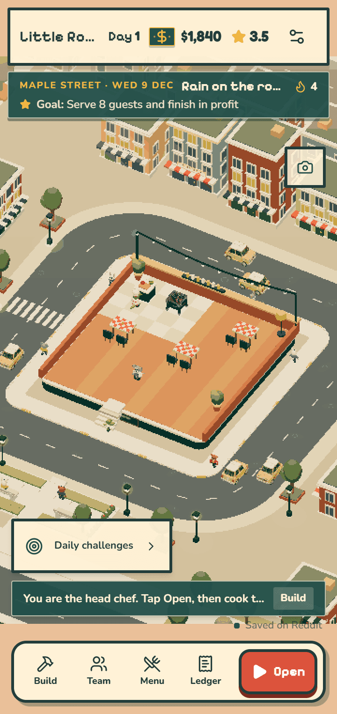
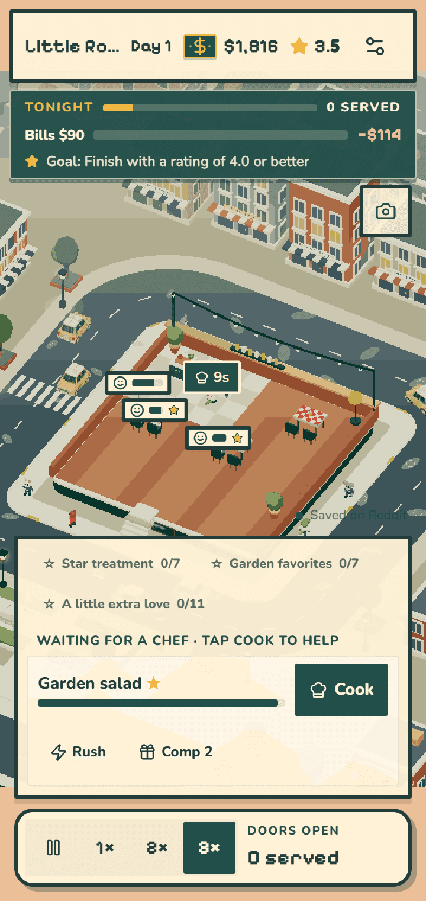
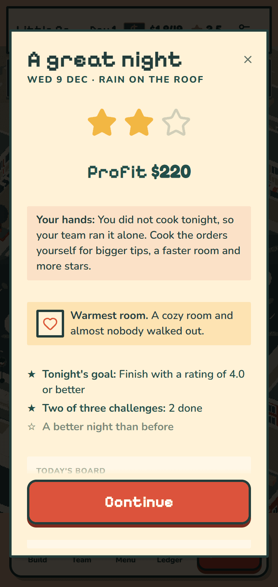
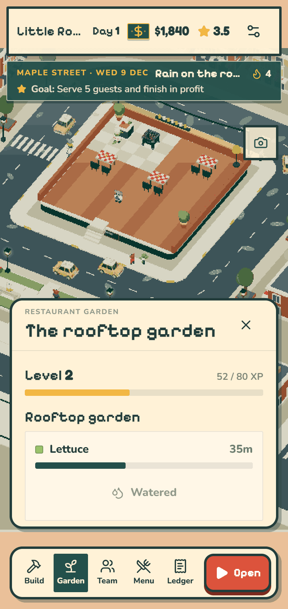
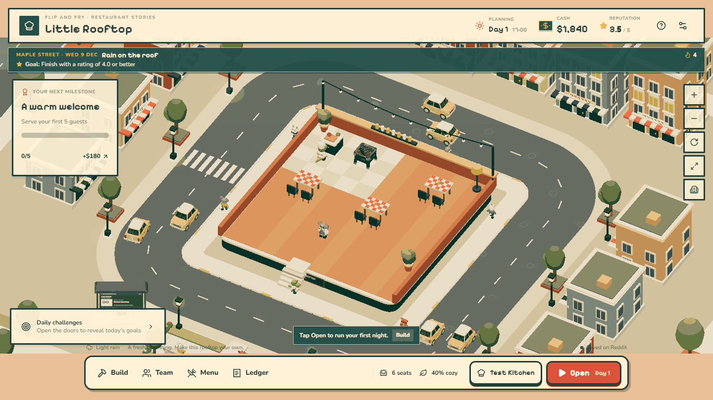

# Flip and Fry

**An action-tycoon about one night a day: set up your rooftop restaurant in the morning, then be the head chef for the evening service.** It lives inside a Reddit post. Every day brings a new neighborhood headline. You build the room, hire the crew, set the menu, open the doors for one night, and Reddit's server replays your service to lock in the result. Built for Reddit's **Game of the Day** hackathon on Devvit Web.

> **This is a port of a game we already owned.** The browser version (a React Three Fiber restaurant tycoon called *Too Many Cooks*, tagged `pre-devvit` in this repository) was reworked for Reddit. See [What changed in the port](#what-changed-in-the-port).

<table>
<tr>
<td align="center"><br><sub>Planning</sub></td>
<td align="center"><br><sub>Service: bills, goal, the pass</sub></td>
<td align="center"><br><sub>The result card</sub></td>
<td align="center"><br><sub>The garden</sub></td>
</tr>
</table>

<br><sub>On a desktop window. Screens are captured by <code>tools/look-shot.mjs</code> from the running game with a stand-in daily post.</sub>

## How to play

Run the pass of a rooftop restaurant: cook the orders, earn up to three stars, come back for tomorrow's headline.

1. Open today's post. The headline (for example *Rain on the roof*) and a goal for the night are at the top.
2. **Build:** place tables, planters, lanterns and kitchen equipment. **Team:** hire and train. **Menu:** switch dishes on and set prices.
3. Tap **Open** (your first service is a one-minute **lunch**; after that choose lunch or dinner). **You run the pass.** Parties wait at the door: tap a table to **seat** them (a ✦ cosy table, with decor nearby, tips more), **take their order**, **cook** it (tap **Cook**, or **Take over** from a chef who has just started; **Flip**, **Stir** or **Toss** when the marker is in the box; plate in the green zone), **serve** it and **clear** the table. Each quick move adds to your **combo** (⚡), which raises tips. One **decision** at a time comes up (a complaint, an allergy, a supplier). **Rush** moves a ticket up, **Free meal** keeps a guest who is about to walk. Your team does all of it more slowly if you leave it, but a night where you do nothing earns few stars, and the result card says so. If you lose money night after night the bank sends a final notice, then takes a few of your pieces into storage; it never takes the restaurant. A neighbor can help at your pass (**Cook together**).
4. When the night ends the server replays it and gives you up to three stars: the headline goal, two of three daily challenges, and beating your last night. Your first three nights have a gentler goal (serve 8 guests and finish in profit), so a new owner always sees a star.
5. **Between nights**, tend the **Garden** (Reddit only): plant, water and harvest crops on real timers, spend the harvest in your dishes (free ingredients, tips 15% more), fill the order board for cash and XP, turn produce into stock, dough and pickles in the workshop, put your builder on a better stove, give each chef a station, and save three layouts of your room to switch between. Level up for more plots, seeds and a second builder.
6. Come back tomorrow. A new headline arrives, your streak grows, and the neighbors have been busy.

Between nights you can step into the **Test Kitchen** and cook by hand: three shifts, solo or two chefs, and a **Today's shift** picked by the date. New stars there earn a little research for your restaurant (at most 10 a day), and a result can be posted to the thread with the same confirm step as the restaurant's.

## The daily headline

The weekday picks the kind of night; the numbers behind it do not change. Each kind has three tellings, one a week, so the title reads differently three weeks running (21 distinct titles).

| Day | Headline | What it changes |
|---|---|---|
| Mon | A quiet neighborhood | More patient guests, a wider arrival gap |
| Tue | The boulevard is busy | Guests arrive faster |
| Wed | Rain on the roof | Slower walking, comfort counts more for tips |
| Thu | The butcher raised prices | Grill ingredients cost 50% more |
| Fri | A critic is in the neighborhood | More VIP guests; one VIP walkout caps the night at 2 stars |
| Sat | Payday | Guests are less put off by a high price |
| Sun | The inspector comes at closing | Dirty seats at closing hurt the rating |

## What is on Reddit

- **One official service a day.** The server opens your night from your saved restaurant and replays it with the same deterministic engine the game runs on. Only the server's receipt counts, so stars cannot be faked from a browser.
- **Your restaurant is saved on Reddit** (Redis), per player, so it follows you across devices and survives app updates. The Test Kitchen's scores and outfits are saved the same way.
- **Stakes you can see.** During service the header shows the bills (wages, rent and any loan instalment) against what the till has taken, and tonight's goal. The result card shows the till line by line and what the night did to your reputation, which sets how often guests arrive tomorrow.
- **Today's board:** the night's official results on the subreddit, from the server's replays. Names show only for neighbors who left their door open.
- **A streak** of days with at least one star (a freeze is earned every 7 days and absorbs one missed day, up to two held), and flair that goes with it (tiers at 1, 3, 7, 14 and 30 days). Flair is a reward for a real streak, never for a comment or a vote.
- **Post this result**, **Wear flair** and **Follow this community** are three separate, optional buttons. Each shows exactly what it will do first ("This posts as you"), runs only when you tap it, and nothing in the game waits for any of them.
- **Cook together:** invite one neighbor to help at your pass for the night, or help in someone else's. Two devices run the same deterministic engine in lockstep over realtime, and the server replays the host's log, helper included.
- **Reminders and badge:** an optional, opt-in reminder when a streak is at risk (Reddit's push beta), and the game badge linking to today's post.
- **The neighborhood:** neighbors who have the post open come over as guests while you serve; you can leave your door open for visits, visit one of four sample kitchens (always labelled as samples), read a bulletin of notes from visitors, and post your kitchen as its own post.
- **The thread is the street:** each day's post is highlighted and carries a stickied results comment; the app comments a short report on the day that just ended.
- **Journeys** instrument the whole loop; the final event is written by the server from the replayed result.

## For moderators

- **Post today's service** (subreddit menu) creates the day's post. It is also created automatically by the first player request of each UTC day and by a scheduled job, and the three cannot create it twice.
- **Highlight today's post** (subreddit menu) pins it in community highlights. The app needs moderator permission for this and for setting user flair.
- **Settings:** *Neighborhood name* (shown on the daily bar; letters, numbers, spaces and apostrophes, up to 24 characters) and *Allow open doors* (on by default).
- Posts and comments made on a player's behalf run as the **app account** until the app is approved, except for the app's owner. The demo is shown with the owner's account.

## Controls

| | Keyboard | Touch |
|---|---|---|
| The restaurant | Click and tap everywhere. `R` rotates a piece being placed, arrow keys nudge it, `Esc` cancels, `Space` pauses service | Tap. Every control is at least 44 px |
| The pass | Tap **Cook**, then **Plate it** | The same |
| Test Kitchen, one chef | `WASD` move, `E` pick up and put down, `F` hold to work, `Space` dash | A stick plus **Work**, **Pick** and **Dash** buttons |
| Test Kitchen, two chefs | Chef 2: arrows, `K`, `L`, `J` | Needs two keyboards |

## Accessibility

Every control has a visible label and an accessible name. Meters and thoughts are spoken as text, so colour is never the only signal. Reduced-motion preferences are respected. Touch targets are at least 44 px, and the layout works from 360 px wide.

## What changed in the port

- The Redis-backed **park**: your restaurant, saved by the server and changed only through validated actions.
- The deterministic **action log and replay**: the server is the only source of a score.
- The **daily headline**, shared **daily challenges**, stars and the streak.
- **Twelve dishes in three menu styles**, five appliances, contracts, regulars, research and guest thoughts.
- **The owner at the pass**: cook a ticket by hand during service, with the quality worked out by the engine from simulated time (a client cannot claim a perfect plate).
- The **pixel presentation** of the existing 3D scene (palette-snapped, with an automatic pixel size so it stays readable on a phone).
- The **Test Kitchen** (the original hands-on arcade) mounted with touch controls and server-side saves.
- Every Reddit feature above.

The decisions behind each of these, including the ones we refused, are in [`docs/build-log.md`](docs/build-log.md).

## How it works

- `src/management/` is the game: a fixed 0.1 second step with a seeded random source, whose only inputs are the saved state and an action log. `runService(state, actions, headline)` is a pure function and returns the receipt. Its hash is identical in Chromium, Firefox and WebKit (`npm run test:engines`).
- `src/server/` is a Hono app on Devvit Web. `core/` holds the rules behind a small `Store` interface, so they run unchanged in tests against an in-memory Redis.
- `src/client/` is the Reddit entry: a static splash (no 3D) that opens the expanded game on tap.
- Calibration bots (a bare, a cozy and a greedy menu) run the engine in tests over many dates, so a change that breaks the daily goals fails the build.

## Documentation

Everything about how this was built and why is in [`docs/`](docs/README.md): the story from the browser game to the Reddit game, the architecture, every design and engineering decision, how the game uses Reddit and Devvit, the testing approach and the dated build log.

## Develop

Node 24 and npm. Install with `npm install`.

```bash
npm run lint
npm test                # unit tests, then the browser tests (Playwright, Chromium)
npm run test:engines    # the same receipt in Chromium, Firefox and WebKit
npm run build:devvit    # build the client and server for Devvit
npx devvit playtest     # run on your own test subreddit
npx devvit upload       # upload a new version
```

`devvit.json` is the app's configuration. The game never makes outside network requests (`permissions.http.enable` is `false`). Do not run `build:devvit` while `devvit playtest` is running on Windows.

## Playing outside Reddit

`npm run dev` runs the original browser game, with its progress saved in the browser and no headline, stars or neighborhood.

## Credits

- Fonts: [Fredoka](https://fonts.google.com/specimen/Fredoka), [Nunito](https://fonts.google.com/specimen/Nunito) and [Pixelify Sans](https://fonts.google.com/specimen/Pixelify+Sans) (SIL Open Font License), through `@fontsource`.
- Icons: [Lucide](https://lucide.dev) (ISC).
- Characters, furniture, the city, weather and lighting are procedural and authored in this repository.
- The 3D props, music and sound effects in `public/assets/` and the original icon were made by the project's author using free, partly AI-assisted tools (the author's statement). See [`docs/assets-provenance.md`](docs/assets-provenance.md) for what is known about each file.

## License

The code is released under the [MIT License](LICENSE). Fonts, icons and libraries keep their own licenses (see Credits). The 3D props, audio and original icon are covered by the notes in [`docs/assets-provenance.md`](docs/assets-provenance.md), not by the MIT grant.
