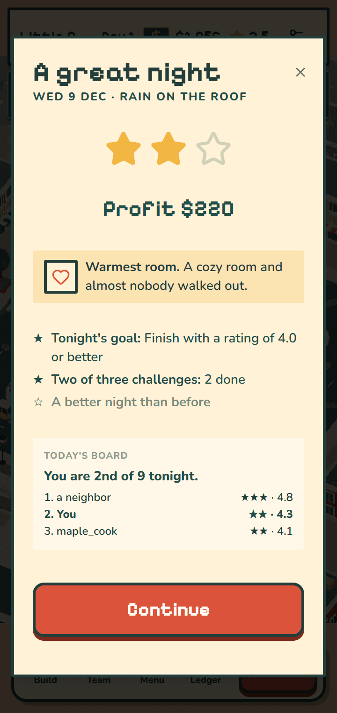
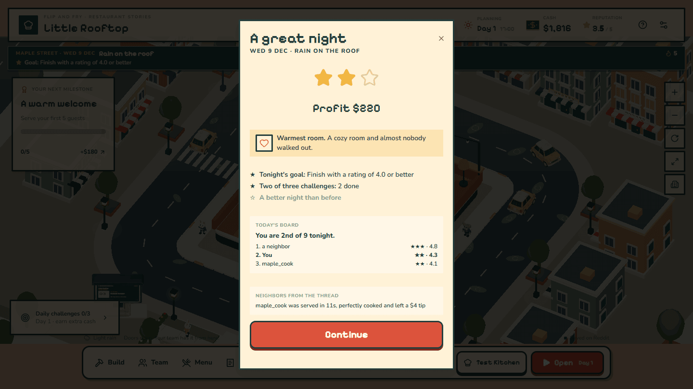

# Using Devvit and Reddit

Every platform capability the game uses, what for, the limits it works within, and the one thing in each that is not yet confirmed on a real device. The reasoning behind the choices is in [`design-decisions.md`](design-decisions.md); the platform problems we hit are in [`devvit-feedback.md`](devvit-feedback.md).

 

## Capabilities used

| Capability | What it does here | Where |
|---|---|---|
| **Interactive post, inline and expanded** | A tap-only splash in the feed (no 3D, no server call) opens the full 3D game in expanded mode. The game never auto-expands. | `src/client/splash.*`, `game.*`, `devvit.json` `post.entrypoints` |
| **`postData`** | The day's date, headline, title and blurb ride on the post (about 300 bytes of the 2 KB), so the splash shows today's story with no request. A kitchen post carries the kitchen's name. | `daily-post.ts`, `splash-text.ts` |
| **Redis** | Parks, services, results, streak bits, presence, doors, bulletin, the Test Kitchen save, hosted sessions. Designed around TTL-per-key, no scan, no field expiry. | `src/server/core/*` |
| **Scheduler** | `roll-day` (00:05), `night-report` (00:20), `streak-reminders` (17:00). The cron timezone is undocumented, so every job has a lazy twin. | `devvit.json`, `routes/scheduler.ts` |
| **Triggers** | `onAppInstall` (make the first post), `onCommentDelete`, `onPostDelete` (forget stored ids; idempotent). | `routes/triggers.ts` |
| **Menu items** | Moderator: post today's service; highlight today's post. | `routes/menu.ts` |
| **Subreddit settings** | `neighborhood` (checked by a validation endpoint) and `openDoors`. | `devvit.json`, `routes/settings.ts` |
| **Realtime** | A live toast when a neighbor visits; the channel for hosted service. Server-send only, `coop_<hostId>` and `visits_<hostId>` (no colons). | `routes/api.ts`, `client/{coop,visits-live}.ts` |
| **Comments as the user** | "Post this result" and the Test Kitchen result, each a canned line with a confirm step. | `core/social.ts` |
| **Custom posts as the user** | "Post my kitchen" (`userGeneratedContent`), now with a picture. | `core/kitchen-post.ts`, `core/media.ts` |
| **Flair** | A streak flair (tiers at 1, 3, 7, 14, 30 days), set from its own button. The daily post's flair is the headline. | `core/social.ts`, `daily-post.ts` |
| **Subscribe** | Its own button; stored in Redis because there is no API to ask. | `core/social.ts` |
| **Community highlights** | The daily post is highlighted at creation, and by menu. | `daily-post.ts`, `menu.ts` |
| **Text fallback** | Every daily post has a Markdown description of the headline for old Reddit, search and bots. | `daily-post.ts` |
| **Journeys** | The whole loop, with the server writing the official end from the replayed result. | `client/journeys*.ts`, `routes/telemetry.ts` |
| **Push notifications** | An opt-in switch and one reminder a day for an at-risk streak; the game badge links to today's post. | `core/notify.ts` |
| **Media upload** | A card image on kitchen posts. | `core/media.ts`, `management/kitchen-card.ts` |
| **Snoovatars** | The avatar on a neighbor's tag, with a pixel face as the fallback. | `core/avatar.ts`, `NeighborAvatar.tsx` |
| **Moderator menu: retention report** | Totals only (players, today, 30 days, day 1, 7 and 30 return rates, lapsed share), from ids recorded as players play. No names. | `core/retention.ts`, `routes/menu.ts` |
| **Developer-account CLI** | `upload` and `install` for every device check; `playtest` is avoided on Windows (see feedback). | |

**Not used, on purpose:** payments (a real charge needs review and would gate play), outside HTTP (`permissions.http.enable: false`, because the docs say it defaults to true), blob storage, external endpoints, and `devvit publish` (App Review) during the hackathon.

## Limits we design inside

- Request limit **30 s**; a replay takes about **10 ms**, a lock about 40 Redis commands.
- `postData` **2 KB**; realtime **100 messages/s per installation** and 1 MB each (a hosted night sends a few per minute); Redis has **no scan**, so lists are sorted sets or hashes with known keys.
- Redis **TTL is per key**, so anything that must expire is its own key.
- Inline posts: tap and click only, load fast, no scroll traps.
- User actions (Reddit's rules): ask before acting for the player, act only after an explicit button, never gate play on a comment or follow, keep post, comment and subscribe separate, never spam. Upvotes and karma never touch the simulation.

## Behaviour before App Review

Posts and comments made "as the user" run as the **app account** for everyone except the app's owner until the app is approved. The demo is shown with the owner's account. Journey events may be dropped until Reddit allowlists the journey map, so streaks come from the server's replay and nothing depends on them.

## Unconfirmed on a real device (each fails softly)

| Item | If it does not work |
|---|---|
| A failed `EXEC` returns an empty result rather than throwing | Both are treated as a conflict and retried |
| The app account may set flair and highlight a post | The post is made without them; the README tells a moderator what to grant |
| Commenting and posting as the user | The action fails with a message and nothing else changes |
| The settings form accepts the validation endpoint's response | The name is still checked before it is shown |
| `media.upload` accepts a data URI | The kitchen post is made without a picture |
| `context.postData` is set in the inline entry | The card shows the plain text |
| Reddit's CDN avatar loads in the webview | The pixel face stays |
| Push notifications (a gated beta) | The switch says reminders are unavailable |
| Realtime latency on a phone | A helper who falls behind resyncs; the input delay can be raised |

## Verified on a phone

On the author's Android phone in the Reddit app: the 3D scene renders (no black canvas), loads in 2 to 4 seconds, taps work, and the pixel look reads at 360 px wide after the automatic pixel size was added.
