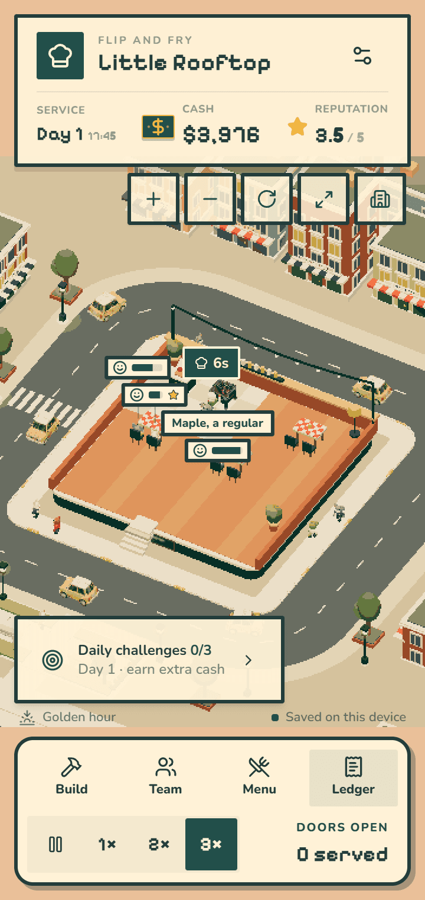
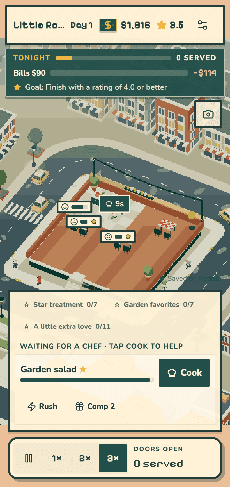
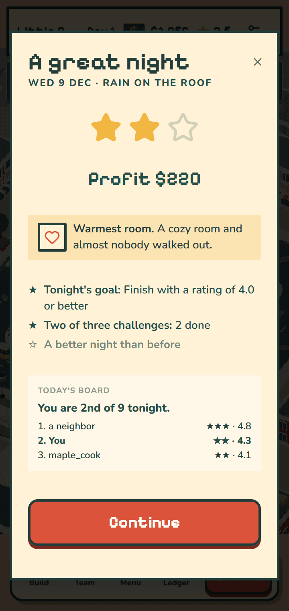

# How Flip and Fry was built

From a browser game to a Reddit game, in the order it happened. Dates are 2026. Decisions and evidence for each step are in [`build-log.md`](build-log.md); this is the story around them.

## Where it started

The project began as **Too Many Cooks**, a browser restaurant tycoon: React 19, React Three Fiber, Vite and Vitest. A 3D rooftop restaurant on a grid; an autonomous crew of four animal species (mouse, rabbit, bear, crocodile) that cook, serve and clean; a menu of two dishes; a seeded, fixed-step simulation (guests, patience, prices, tips, wages, rent, a recovery loan, milestones, daily challenges); a living 3D city with weather; and, beside it, a hands-on arcade kitchen (`KitchenEngine`, three shifts, two chefs) that had never been wired into the main game. It saved to `localStorage` and had 502 unit tests and 132 browser tests. That state is tagged **`pre-devvit`** in git and is the baseline the port statement refers to.

## The challenge

Reddit's **Game of the Day** hackathon (Devpost, closing 8 December 2026) asks for a daily game that runs as a Reddit post, and judges four equal things: delightful UX, polish, "Reddity", and daily content. The target was **Best Ported Daily Game**, which also counts for Best Daily Game. The rules add hard requirements (a README in the repo, a public demo subreddit under 200 members, a port statement) and soft ones (streaks and snoovatars as named bonuses, no AI slop, one result card).

## Steps, in order

### 1. Read the rules, write the plan, review it against the code (18 Nov)
The first plan (written in Cursor) was compared with the engine line by line. Several things did not survive: the demo subreddit must be *public*, the README is *required*, `permissions.http` defaults to *true*, a Lock button adds a decision the Overview warns against, and a free-form pass inside the night cannot be replayed on the server. The plan was rewritten around one idea: **make the engine a pure function** so the server can replay a night and clients can run it in lockstep. Nothing was cut; everything (presence, visits, co-op, research, regulars) was re-expressed as inputs to that function.

### 2. The deterministic core (gates G0 and G2)
`autoRoll` and a public `tick()` on the engine; `Math.hypot` replaced by `Math.sqrt`; a zod action log; `runService`; a canonical state hash. The first big risk, that Chromium, Firefox and WebKit would disagree on the hash, was tested first: 96 fixtures hash identically in all three.

### 3. The headline and the economy (G3)
Seven weekday headlines as weights on existing formulas, shared daily challenges, star rules, and three **calibration bots**. The first run showed the starter economy did not discriminate at all. See "Problems and how we solved them".

### 4. The server (G4) and the client shell
Park, open, lock and streak on a `Store` interface with an in-memory Redis that enforces Devvit's limits; then the existing game mounted on top of it as a thin `Session`. The app was registered as **flip-and-fry** (the first name was taken), uploaded, and installed to the playtest subreddit. Spikes S1 and S2 passed on the author's Android phone: the 3D scene renders, no black canvas, a 2 to 4 second load.

### 5. Pixel presentation and the first phone feedback
The 3D scene was rendered small and snapped to per-weather palettes. The first screenshots from the phone said it was too pixelated to see what was going on, and that it was unclear what the player does. Both were fixed: an automatic pixel size, a dpr-1 canvas, 24-colour palettes, a header that no longer overlaps, the headline weather driving the scene, and, more importantly, **the owner at the pass**.

### 6. The pass, the end-of-night card and the Reddit actions
The owner cooks tickets with a timing bar whose quality the engine computes; a night card with stars, an award, a kitchen card and company value; and the explicit Reddit buttons (comment, flair, follow), each with a preview. The server's lock gained night stats and the triggers that keep stored ids honest.

### 7. Depth (P6)
Dishes as data (twelve, three styles), five contracts, guest thoughts, named regulars, a research budget, reputation on the sign. Several plan items were refused with reasons (a chef-only starter park, bills on tables).

### 8. The Test Kitchen (P7)
The old arcade, mounted as its own lazy chunk with touch controls (a stick and three buttons), saved on Reddit in Redis, with a daily shift and a small research bonus, and its results posted through the same confirm flow.

### 9. The street (P8)
Neighborhood name and a nightly report; presence diners (neighbors with the post open come over, written into the opening snapshot); open doors, four sample kitchens, visits and a bulletin; "post my kitchen"; a live toast over realtime; push reminders and a game badge; a picture on kitchen posts; real avatars with pixel-face fallbacks; and, last, **hosted service**, where a neighbor helps at your pass in lockstep.

### 10. Look, sound, listing
The interface got the pixel look (a font chosen after one was rejected for width), a generated soundtrack that follows the weather, a pixel icon and an inline card that tells today's story from the post's own data, and the animals got drawn portraits.

### 11. Verification and optimization
Whole-loop browser tests, a judging-week rehearsal, a size guard, quality tiers, Latin-only fonts, then (with the author's go-ahead) compression of the models and audio.

### 12. The second plan: a screen that reads as a game
Phone feedback again: the screen was a dashboard, nothing was at stake, and the pixel blocks on a desktop window were too big. [`plan-v2.md`](plan-v2.md) answered with a one-row header, a two-line daily bar, one hint, a one-row dock, a night bar that shows the bills, a result card that shows the till and reputation, today's board, streak freezes and a retention report for moderators. The pixel size became 1 everywhere.

### 13. Documentation
This set of documents, the README, asset provenance and feedback notes for the developer survey.

## Problems and how we solved them

| Problem | How it showed up | What we did |
|---|---|---|
| The engines might disagree | The lock, lockstep and bots all depend on identical results | Tested first. Replaced `Math.hypot` with `Math.sqrt`, made the hash canonical (key order), and hash 96 fixtures in three engines |
| The economy did not discriminate | A bold-price bot beat the fair bots on every headline; a second chef changed nothing | Steeper price slope, a discount demand lift, atmosphere shortening the gap, and a second server as the good first hire; then locked in as tests |
| Reddit's cron timezone is undocumented | The daily post might not exist when someone plays | The first player request of a UTC day creates it too, with a claim that makes the cron and the request safe to race |
| Redis has no scan and per-key TTL | Presence, doors, bulletins and the like need lists that expire | Sorted sets and hashes with known keys; anything that must expire is its own key |
| A finished service looked finished before it began | The client locked a night that had not started (the finish watcher was armed on the closed snapshot) | Arm the watcher only after `open()` succeeds; a test pins it |
| A lost lock race stranded the player | A stale open entry made every reload re-enter a service that could not close | The server drops the open entry on conflict |
| The first phone screenshot showed an old build | Uploads are not installed automatically | `devvit install ... @latest` after each upload |
| `vite build` crashed the playtest watcher on Windows | An `EPERM` on `dist/` | Use upload and install for device checks |
| The pixel pass drew a black canvas | A duplicate colour-space shader chunk, and texture orientation | Removed the duplicate include; fixed `flipY` for the lookup textures |
| The scene was unreadable on a phone | Pixel size fixed at 3 gave 120 scene pixels across | Automatic size by width, dpr 1, 24-colour palettes |
| The daily bar covered the stats and the camera buttons | Seen on the phone | Moved into the header flow; camera buttons to the middle right |
| Nobody knew what to do | Phone feedback | The pass, a coach line tied to the real state, and a goal on the bar |
| zod re-ordered keys and changed hashes | A hash mismatch with no state difference | Canonical sorted-key JSON in `stateHash` |
| A Windows file case clash | `Coop.tsx` and `coop.ts` in one folder | Renamed the component file |
| Fake Redis hid a trimming bug | A negative-end rank range behaved as "to the end" | Fixed the fake to follow Redis; the bulletin test then caught the real bug |
| Browser tests flaked under load | An animating dialog meant a click target never looked stable | Wait for the dialog to close; a direct click where timing is the only issue |
| Hosted tests drifted on timing | Requests finished after the test moved on | A `settle()` helper and awaiting the hosting end before disconnecting |
| The pixel font's 5 read as an S | A rating showed as "3.S" | The digit 5 alone comes from Fredoka through a one-character font face |
| An install failed once right after upload | "Failed to prepare deployment for upgrade check" | Retry; noted in the feedback file |
| A safety check blocked a harmless script | A false positive on a script with no deletion | Wrote the script with the file tool instead of a shell heredoc |

## Where it ended up

<table><tr>
<td align="center"> Before plan v2</td>
<td align="center"> After: bills, goal, the pass</td>
<td align="center"> The result card</td>
</tr></table>

The numbers at the time of writing: 981 unit tests, 231 browser tests, a three-engine hash test, lint and both typechecks clean; installed as version 0.0.17 on `r/flip_and_fry_dev`. What is not built, and what needs a device or an approval, is in [`submission.md`](submission.md) and [`devvit-and-reddit.md`](devvit-and-reddit.md).
