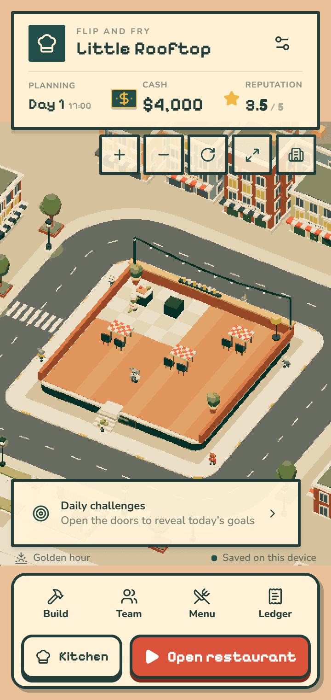
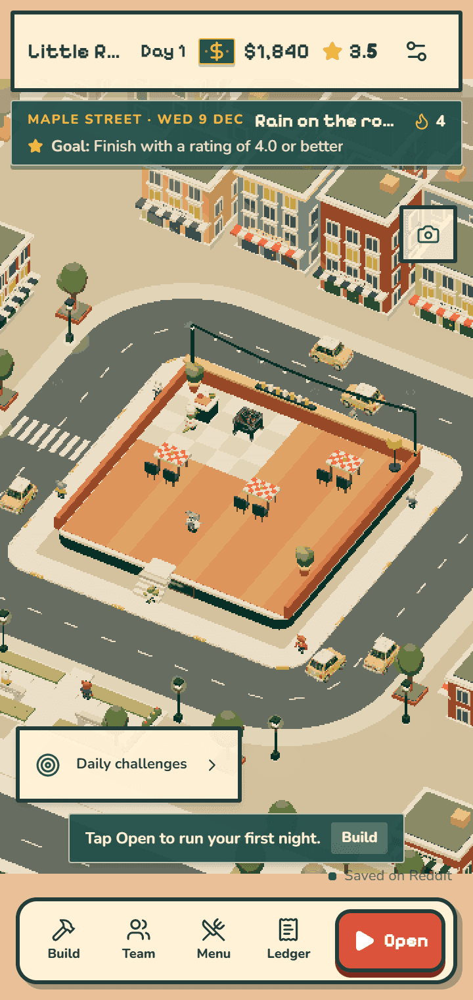
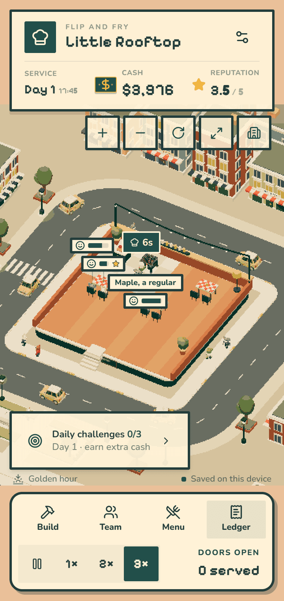
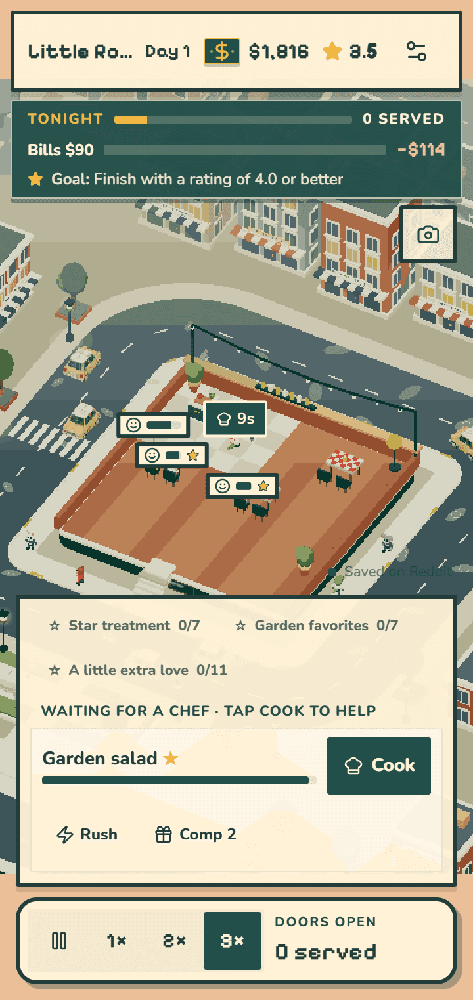

# Plan v2: from "it works" to "it is a game people want to open tomorrow"

Written 19 November 2026; phases A, C, E and F built on 20 November (status in [`plan-status.md`](plan-status.md)). Written after the first plan ([`hackathon-plan.md`](hackathon-plan.md), status in [`plan-status.md`](plan-status.md)) was built out. The first plan answered "can this run on Reddit, verified?". This one answers what the author's screenshots showed: **you cannot tell what the game is, nothing is at stake, and the screen is crowded.** Deadline: 8 December 2026, 6 pm PT (19 days). Feature freeze proposed for **Sat 5 December**; the last three days are fixes and the demo video only, because judging (9 to 16 December) needs a stable app.

## 1. What is wrong, from the screenshots

| Seen | Why it hurts | Judging line it fails |
|---|---|---|
| The scene is drawn in 3-pixel blocks on a desktop window; buildings and animals turn to noise | "Too pixelated" to read | Visual craft |
| On a phone the welcome card, five camera buttons, the daily-challenge card, a status line and a two-row dock all share one 360 px screen and overlap | Looks like a dashboard, not a game; the 3D room is a third of the screen | Visual craft, focused gameplay |
| A wide banner says "Set up first: build tables and decor, hire a team, set prices. Then tap Open", with a goal, a streak counter and a header on top of it | A wall of instruction before any play | Intuitive onboarding |
| Cash, reputation, day, weather, challenges, report, seats, cosiness, "saved" all visible at once while planning | No single thing to look at | Focused gameplay |
| Nothing says what a bad night costs. Rent and wages exist in the engine but are invisible; a missed star changes nothing (by design, see `design-decisions.md`) | No stakes, so no reason to care or return | Daily content, retention |

**Already fixed (19 Nov):** the scene's pixel size is now always 1 scene pixel per CSS pixel (it was 3 on desktop). The 24-colour per-weather palette and hard edges still give the pixel look; `?k=2` brings the blocks back for comparison and `?pixel=0` turns the look off. Evidence: `tools/look-shot.mjs`, screenshots under `tools/pixel/out/look-*.png`. If the author still finds the palette look wrong on a real phone, the fall-back is `pixel=0` as the default (one line).

Before and after on a phone (before: the crowded layout of 19 November; after: phase A and C, 20 November):

   

## 2. What the organisers asked for, and what each means for us

| Their line | Our reading | Phase |
|---|---|---|
| Intuitive onboarding: meaningful play fast, few setup screens, contextual hints, no wall of text | A first night starts in under 30 seconds, from a starter restaurant that already works; three hints at most, each shown once, tied to real game state | B |
| Visual craft: identity, contrast, legible, uncluttered, responsive feedback | One screen, one job. Two layouts (planning, service), each with a small number of things | A |
| Calibrated daily content: bite-sized, variety, fair and solvable, a difficulty curve | A bigger headline pool, a first-week curve, and a bot that plays only what the coach line says and must succeed | D |
| Focused gameplay: start screen shows name, description, date, attribution, stats; remove secondary actions during play | The splash does exactly that; during service everything except the pass, the clock and tonight's goal is hidden | A, C |
| Clear end states and re-engagement: one result card, a meaningful next step | We already have one card. Give it one primary next step, and tomorrow's hook | E |
| Journey events | Done; extend to the first-session funnel and the stakes | F |

## 3. The phases

Order matters: each phase is playable and committed on its own. Phase A is first because everything after it is judged through the screen.

### Phase A: A screen that looks like a game (about 3 days)

**Principle:** at any moment there is one thing to look at. Planning and service are two different screens that share the 3D scene, not one screen with everything on it.

1. **A thin top bar, not a card.** Cash and reputation only, as icon plus number, over the scene. Day, weather and the headline go in one small chip that opens the headline. Name and "saved on Reddit" move into settings.
2. **A three-button dock:** Build, Team, Menu, and one large **Open** button. Ledger, Test Kitchen, the neighborhood, research and Cook together move into one "More" sheet. During service the dock is replaced by the pass (see C).
3. **Camera:** one button (reset) plus pinch and wheel. The five camera buttons go away on phones; on desktop they become a small cluster that fades after 3 seconds.
4. **Panels are sheets, not overlays on the scene.** Phone: a bottom sheet that takes at most 55% of the height and slides the camera up so the room stays visible. Desktop: a right-hand drawer of fixed width, the scene shifts left. Nothing covers the room while you build.
5. **The daily challenges card becomes a chip** on the top bar ("Goal 0/3"), and expands only when tapped. The welcome card becomes a hint (phase B).
6. **Desktop is not a stretched phone.** Above 900 px: top bar, left rail (Build, Team, Menu, More), scene in the middle, the drawer on the right. Check at 1280 and 1920.
7. **Feedback on every tap:** a short sound, a small bounce on the object, money numbers that float up from the table on a tip. No new assets; the audio is generated and the scene already has the objects.

**Done when:** at 360, 390, 768, 1280 and 1920 px the planning screen has at most 6 interactive things and no overlap (the existing overlap test is extended), and the room is at least 60% of the screen. A phone screenshot is attached to the build log.

**Refused:** a new component library; a full redesign of every panel at once (the Build and Menu panels get the sheet container first, their insides later); more pixel effects.

### Phase B: The first sixty seconds (about 2 days)

1. **New players skip planning.** The first visit starts with a working restaurant (it already has one) and one pulsing button: **Open**. The first service is a short one (the first headline's goal is reachable by doing nothing wrong) and teaches by doing.
2. **Hints from state, not from a script.** At most three, each shown once and stored locally and in the save: "A ticket is waiting: tap Cook" (the first time a ticket waits), "Hold Prep, release in the green" (the first time you cook), "Tomorrow: spend cash on a table" (after the first card). No modal, no "Next" buttons, no wall of text.
3. **After the first night** the card offers exactly one next step: "Build something with your $X". Planning opens with the Build sheet already showing the one best-value item, highlighted.
4. **Skippable and invisible to returning players.** A flag in the save; a Reset in settings for demos.

**Done when:** a scripted browser run from a fresh save reaches a closed night and a result card in under 90 seconds of game time with five taps or fewer, and a test fails if more than one hint can be on screen at once.

**Refused:** a tutorial level, a separate onboarding screen, forced steps.

### Phase C: The service screen and visible stakes (about 3 days)

This is the answer to "no stakes".

1. **A service HUD with four things:** the clock, **tonight's goal as a bar** ("$140 of $230"), the **bills line** ("rent $60 + wages $85 due at close"), and the pass. Everything else is hidden. The goal bar turns from red to amber to green as you get there.
2. **Breakeven is on the screen from the first minute of service.** The engine already pays wages and rent and charges recovery-loan interest at close; the HUD just shows them, so a quiet night visibly *costs* money.
3. **Real consequences, none of which delete progress** (this keeps the earlier rule that a missed star never resets a park):
   - **Reputation moves.** A night with unhappy guests (walk-outs) lowers reputation; reputation sets tomorrow's guest count. Two bad nights in a row and the street gets quiet. A great night lifts it.
   - **Streak protection is earned, not free.** A streak holds on a 1-star night; it breaks on a missed day. One **streak freeze** is earned per 7 nights, shown on the card, spent automatically. (Loss aversion is the common explanation of why streaks work; the sources are thin, so we keep it modest and visible instead of punishing.)
   - **Rough night.** If cash would go negative at close, the bank covers it as the existing recovery loan, with interest, and the card says so in one line. Debt is the stake.
   - **Critic night and payday** (already headlines) get a visible stake: a star rating swing.
4. **Today's board.** A top-ten of today's nights on this subreddit (profit on today's headline, from the server's own replay, so it cannot be faked), with your rank shown on the card. It is the part of the game that is *about other people*, which is what Reddit is. One sorted set per day with a 3-day expiry; names only for players who left their door open, others show as "a neighbor".
5. **Weekly arc.** Mon to Sun stars add up to a weekly rank (Bronze to Gold); Sunday is "Restaurant Week" with a bigger goal. This gives a reason to come back on day 3, 5 and 7.

**Done when:** the HUD test checks each of the four elements against the engine's own numbers; the bot calibration (21 dates and the judging week) still passes after the reputation and freeze changes; the golden hashes are refreshed once and the *reports* are shown unchanged for nights that do not touch the new rules; a server test proves the board cannot be written by anyone but the lock.

**Refused:** resetting the restaurant on failure; real-money anything; upvotes or karma as inputs; a leaderboard built from client-reported numbers.

### Phase D: Daily content that stays fresh (about 2 days)

1. **Headline pool of 21, not 7.** Each weekday keeps its flavour; three variants per weekday are chosen by the date, so a player sees a new one every day for three weeks. Modifiers are still weights on the existing formulas, so nothing else changes.
2. **A first-week curve.** Day 1 goal reachable by a new player following the coach; day 2 introduces price; day 3 the second cook; day 5 research; day 7 Restaurant Week. Written as data next to the headlines.
3. **A new-player bot** that follows only the coach hints (no research, no menu changes) and **must earn 1 star on days 1 to 3**; this is a calibration gate in the tests, next to the existing ones.
4. **A "tomorrow" teaser:** the card shows tomorrow's headline name (it is a pure function of the date), so there is something to return for.

**Done when:** the new-player bot passes, a test confirms 21 distinct headline and weather combinations over 21 days, and the judging week (9 to 16 December) is rehearsed again.

### Phase E: One result card with one next step (about 1 day)

The card stays a single card. Changes: the stars and the **bills line** first (win or loss is clear in one glance); the rank on today's board; the streak and its freeze; tomorrow's headline; and **one primary button** ("Post this result"), with comment, flair, follow and kitchen post under a "More" fold. No second end screen. The next step for a first-time player is "Build", for a returning one "Tomorrow: {headline}".

### Phase F: Measure it (about 1 day)

Devvit Journeys already records the loop. Extend the event list to cover the first-session funnel and the stakes, and add a moderator-only report so we can read retention without leaving Reddit.

| Question (from the metrics list) | How we answer it here |
|---|---|
| Retention D1, D7, D30 | Each player already has a per-day bitfield (it drives the streak). A moderator menu item, "Retention report", counts players who returned 1, 7 and 30 days after their first night, as totals only. No names |
| Churn | Players seen in the last 30 days but not in the last 7, from the same bits |
| DAU, MAU, DAU/MAU | The same bits: distinct players today and in the last 30 days |
| Session length and frequency | Journeys: open to close of a service (server time), and nights per player per day |
| Progression funnel | Journey nodes: splash, game, first_open, first_cook, first_close, card_seen, post_clicked, return_next_day. The server writes the official end, as now |
| Technical stability | The frame watch already knows when it drops a quality tier; count the tiers chosen per day, and request failures per route |
| Monetization (payer conversion, ARPDAU, LTV) | **Not applicable and not planned.** Payments need review and would gate play; it is a design decision recorded in `devvit-and-reddit.md` |

Reference numbers from vendor roundups (directional only): average D1 about 26 to 28%, D7 about 8% and D30 under 3%; "top quartile" 40, 20 and 10%. Our demo subreddit is tiny, so we track the **ratios** and the funnel, not absolute reach.

**Done when:** a menu item returns a small, name-free summary in a toast, tested against the fake store; journey node names are in the privacy note.

## 4. Timeline

| Dates | Work | Exit |
|---|---|---|
| 20 to 22 Nov | A: top bar, dock, sheets, chips, desktop layout | Screenshots at five widths |
| 23 to 24 Nov | B: first sixty seconds | Scripted fresh-save run |
| 25 to 27 Nov | C: service HUD, bills, reputation, freeze, today's board, weekly arc | Bots and goldens |
| 28 to 29 Nov | D: headline pool, curve, new-player bot | Calibration gate |
| 30 Nov | E: the card | Whole-loop browser test |
| 1 Dec | F: retention report, new journey nodes | Fake-store tests |
| 2 to 4 Dec | Phone checks on two real accounts; fixes | Author's checklist |
| 5 Dec | **Freeze.** Re-upload, no `devvit publish` | Version noted in the log |
| 6 to 8 Dec | Demo video, Devpost form, survey | Submitted before 6 pm PT on the 8th |

## 5. Risks

- **The author's judgement of the look matters more than any number here.** After phase A, send a phone screenshot before building on it.
- **Stakes can feel unfair.** Every new rule is a weight on formulas the bots already calibrate; the 21-date gate stays, and a night that loses reputation must always be explainable on the card ("2 guests left").
- **Changing the engine again refreshes every golden hash.** It is done once, in phase C, not per rule.
- **The board and the retention report touch real user names and activity.** Names only for open doors; the report is totals only; both go into `privacy.md`.
- **A bigger scope than days.** If time runs short the order of cuts is: weekly arc, then the board's names, then the new journey nodes. Phase A, B and the bills line in C are not cut.

## 6. Evidence and its limits

The research behind this plan is thin, and I say so: most pages on streaks and retention are vendor blogs and opinion, and one of the Devvit Journeys pages found was a mirror, not Reddit's own site (verify against the official docs before relying on its details). What holds across sources: one puzzle a day creates scarcity and a ritual, low friction and contextual hints beat tutorials, and streaks work through loss aversion. The numbers above are for orientation only.

Sources: [MoEngage on Wordle's retention](https://www.moengage.com/blog/wordle-viral-growth-story/), [GameGrin on streaks and leaderboards](https://www.gamegrin.com/articles/do-streaks-and-leaderboards-still-work), [Game Growth Advisor on retention strategies](https://gamegrowthadvisor.com/blog/2026-03-17-mobile-game-retention-strategies-2026/), [maf.ad on retention benchmarks](https://maf.ad/en/blog/mobile-game-retention-benchmarks/), [Segwise on retention by genre](https://segwise.ai/blog/mobile-gaming-app-user-retention-strategies.md), [PlaytestCloud case study on tutorial and Day 1 retention](https://www.casestudies.com/company/playtestcloud/case-study/how-nitro-games-boosted-day-1-retention-with-iterative-playtesting).
